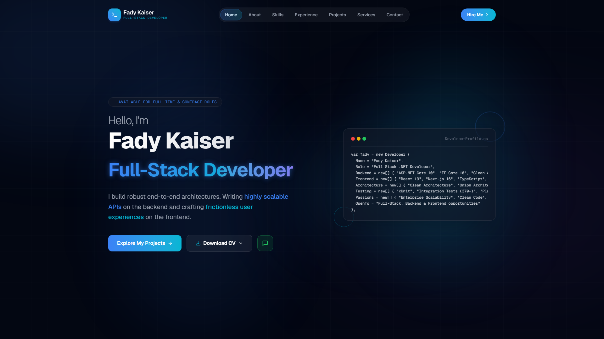
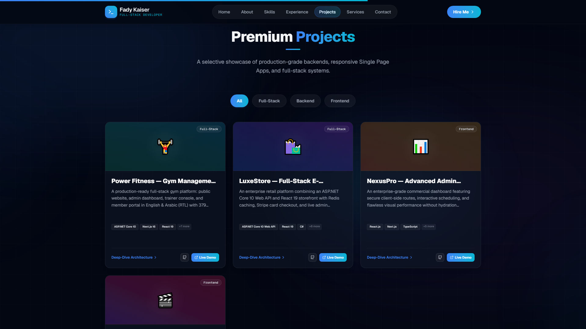
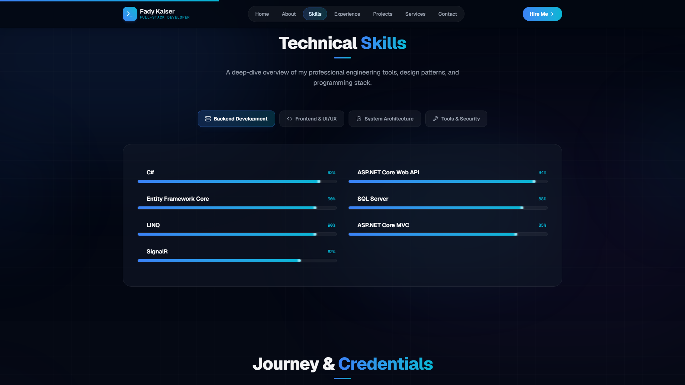
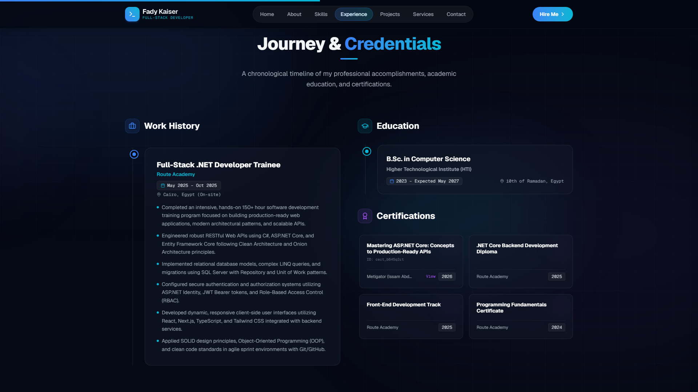

<div align="center">


</div>

<div align="center">

[](https://fady519.github.io/Portfolio-Fady/)
[](https://github.com/Fady519/Portfolio-Fady)
[](https://www.linkedin.com/in/fady-kaiser/)
[](mailto:fadykaiser2004@gmail.com)

</div>

---

<div align="center">

## ✦ Engineered to Impress. Designed to Convert.
**A modern, blazing-fast personal software engineering portfolio built with Next.js 16, React 19, and TypeScript.**  
*Clean Component Architecture · Tailwind CSS 4 · Framer Motion · Interactive Modals · Static Site Generation (SSG)*  
Curated to showcase production-grade full-stack systems, architectural blueprints, verified credentials, and real-world engineering impact.

</div>

---

## 🖥️ Live Showcase

<div align="center">

> 🔗 **Live Demo:** [fady519.github.io/Portfolio-Fady](https://fady519.github.io/Portfolio-Fady/)

</div>

### 1. Modern Hero & Interactive Terminal Showcase
Dynamic greeting, floating skill indicators, direct CV download routing, and interactive C# Developer object snippet.


### 2. Selective Engineering Projects Grid
Multi-category filtering (All, Full-Stack, Backend, Frontend) with 1-click architecture deep-dive inspection modals and live demo triggers.


### 3. Interactive Technical Skills Matrix
Categorized technical breakdown across Backend Development, Frontend & UI/UX, System Architecture, and Tools & Security.


### 4. Professional Timeline, Education & Verified Credentials
Chronological timeline detailing hands-on software development training, academic Computer Science coursework at HTI, and verified industry certifications (including Metigator ASP.NET Core API Mastery).


---

## 🚀 Featured Engineering Projects

| Project | Category | Key Architectural Highlights | Live Links |
|---|---|---|---|
| **🏋️ Power Fitness** | Full-Stack | Clean Architecture, ASP.NET Core 10 Web API, Next.js 16, 96 endpoints, **379 integration tests**, English/Arabic RTL, QR check-in | [Live Demo](https://power-fitness-gym.vercel.app) · [Code](https://github.com/Fady519/GymManagementSystem) |
| **🛍️ LuxeStore** | Full-Stack | Clean Onion Architecture, ASP.NET Core 10, React 19, Redis distributed caching, Stripe checkout, JWT RBAC, live admin console | [Live Demo](https://ecommerce-full-stack-nine.vercel.app) · [Code](https://github.com/Fady519/Ecommerce-FullStack) |
| **📊 NexusPro** | Frontend | Enterprise administrative dashboard, Next.js, TypeScript, FullCalendar scheduling, zero-flicker dark mode, multi-series charts | [Live Demo](https://dashboard-flax-two-20.vercel.app/login) · [Code](https://github.com/Fady519/Dashboard) |
| **🎬 Cinema+** | Frontend | Netflix-inspired movie discovery app, React 19, TMDB REST API (8 endpoints), embedded HD YouTube trailer player, persistent watchlist | [Live Demo](https://fady519.github.io/Cinema-Fady/) · [Code](https://github.com/Fady519/Cinema-Fady) |

---

## ✨ Core Features & Technical Highlights

| Feature | Engineering Description |
|---|---|
| ⚡ **Next.js 16 + React 19 Engine** | Powered by Next.js App Router with Static Site Generation (SSG) for sub-second page loads |
| 🔷 **Strict TypeScript Typing** | Fully type-safe data schemas for projects, credentials, skills, and contact forms |
| 🎞️ **Fluid Framer Motion Micro-Interactions** | Staggered entrance animations, hover spring dynamics, and smooth layout reordering |
| 🎨 **Tailwind CSS 4 Modern Styling** | Modern utility-first CSS engine with zero-runtime stylesheet overhead and glassmorphism UI |
| 🔍 **Deep-Dive Architecture Modal** | Detailed modal views revealing challenges, solutions, and architectural patterns per project |
| 📜 **Verified Credentials Hub** | Direct verification links for accredited certifications (Metigator, Route Academy) |
| 📱 **Zero-Layout-Shift Responsive Design** | Mobile-first geometry adapting seamlessly across all screen viewports |
| 🚀 **Automated Static Export Pipeline** | Clean CI/CD deployment to GitHub Pages via automated build scripts |

---

## 🛠️ Tech Stack & Tooling

<div align="center">

### Framework & Language


### Styling & Animation


### Forms & Deployment


</div>

---

## 📁 Project Structure

```
Portfolio/
├── docs/
│   └── screenshots/              # Production portfolio preview captures
│       ├── 01_hero.png
│       ├── 02_projects.png
│       ├── 03_skills.png
│       └── 04_experience_certs.png
├── public/                       # Static public assets
│   ├── certificates/             # Verified certification credentials
│   │   └── metigator_aspnetcore.png
│   ├── favicon.ico
│   └── .nojekyll
├── src/
│   ├── app/                      # Next.js App Router root
│   │   ├── favicon.ico
│   │   ├── globals.css           # Global Tailwind directives & glass panels
│   │   ├── layout.tsx            # HTML root metadata & font setup
│   │   └── page.tsx              # Single-page application aggregator
│   ├── components/               # High-performance UI components
│   │   ├── About.tsx             # Bio, statistics & educational highlight
│   │   ├── Contact.tsx           # React Hook Form contact interface
│   │   ├── Experience.tsx        # Work history, education & verified certs
│   │   ├── Footer.tsx            # Social channels & copyright
│   │   ├── Hero.tsx              # Interactive introduction & CV selector
│   │   ├── Navbar.tsx            # Sticky navigation with active section tracker
│   │   ├── Projects.tsx          # Filterable projects grid & architecture modal
│   │   ├── Services.tsx          # Value proposition cards
│   │   └── Skills.tsx            # Animated multi-category technical skills grid
│   └── lib/
│       └── data.ts               # Centralized, strongly-typed portfolio data
├── next.config.ts                # Next.js static export & basePath config
├── package.json                  # Dependencies & scripts
├── tsconfig.json                 # TypeScript compiler configurations
└── postcss.config.mjs            # Tailwind PostCSS configuration
```

---

## ⚙️ Getting Started Locally

### Prerequisites

- [Node.js](https://nodejs.org/) `v18.0.0` or higher
- [npm](https://www.npmjs.com/) `v9.0.0` or higher

### Installation

```bash
# 1. Clone repository
git clone https://github.com/Fady519/Portfolio-Fady.git
cd Portfolio-Fady

# 2. Install dependencies
npm install

# 3. Start local development server
npm run dev
```

Open [http://localhost:3000](http://localhost:3000) in your browser.

### Static Build & GitHub Pages Deployment

```bash
# Build optimized static export to /out
npm run build

# Deploy automatically to GitHub Pages
npm run deploy
```

---

## 📬 Contact & Connect

<div align="center">

[](https://www.linkedin.com/in/fady-kaiser/)
[](https://github.com/Fady519)
[](https://fady519.github.io/Portfolio-Fady/)
[](mailto:fadykaiser2004@gmail.com)

</div>

---

<div align="center">


**⭐ If you liked this portfolio, feel free to give it a star on GitHub!**

</div>
